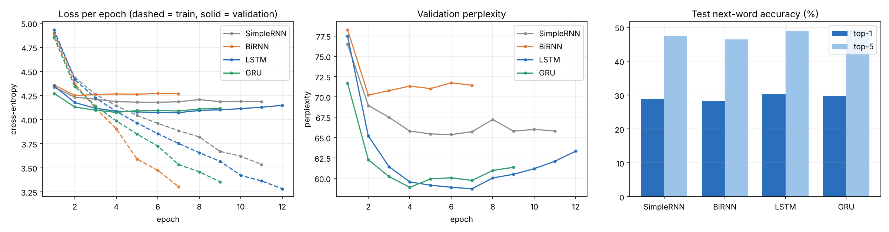
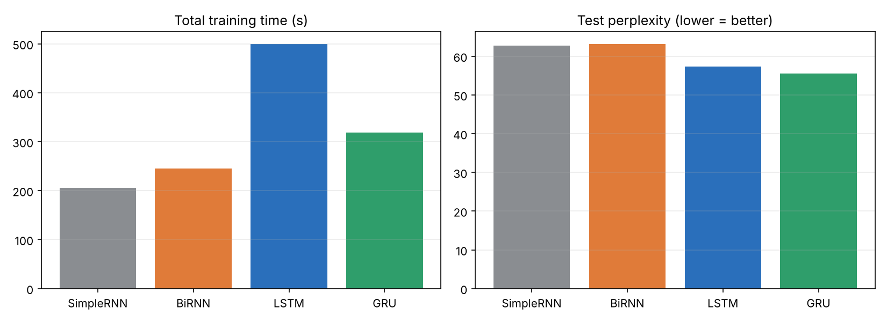
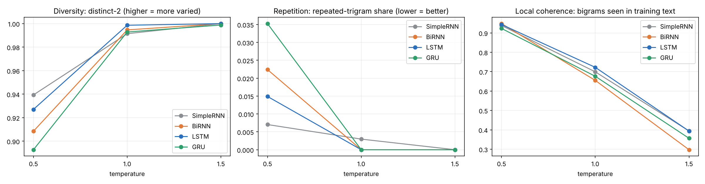

# Autoregressive Word-Level Text Generation on Tiny Shakespeare

**Foundations of Generative AI (ICT4403), Assignment 2**
Simple RNN vs Bidirectional RNN vs LSTM vs GRU, trained under identical conditions to predict the next word and to generate text one word at a time.

## 1. Problem statement and objective
Build an autoregressive text-generation system with four recurrent architectures (Simple RNN, Bidirectional RNN, LSTM, GRU) on a textual dataset of our choice and:
1. preprocess the text and build (input window, target word) pairs;
2. train all four models under comparable conditions;
3. evaluate them quantitatively (loss, perplexity, next-word accuracy, training time) and qualitatively (coherence, diversity, contextual consistency, repetition);
4. generate text from the same seeds at three sampling temperatures, analyse the effect of temperature and decide which model is the most effective generator.

## 2. Dataset
**Tiny Shakespeare**: about 1.1 MB of plain text containing concatenated plays by William Shakespeare (popularised by Andrej Karpathy's *char-rnn*).
Source: <https://raw.githubusercontent.com/karpathy/char-rnn/master/data/tinyshakespeare/input.txt> (a copy is in `data/tinyshakespeare.txt`; the notebook downloads it if missing).

| Property | Value |
|---|---|
| Characters | 1,115,394 |
| Word/punctuation tokens | 290,145 |
| Unique tokens (all) | 12,380 |
| Vocabulary (train words seen ≥ 3 times, + `<pad>`, `<unk>`) | 4,296 |
| Split (chronological) | 80 % train / 10 % validation / 10 % test |
| Training pairs | 232,106 (validation 29,004, test 29,005) |

**Preprocessing:** lower-casing; tokenisation into words (with inner apostrophes), the punctuation marks `. , ! ? ; :` and a `<nl>` token for line breaks; vocabulary built from the training split only (rare words → `<unk>`); sliding window of 10 words (stride 1): input = 10 previous words, target = the next word.

## 3. Models
All four share `Embedding(128) → recurrent layer (256 units) → Dropout(0.4) → Linear(vocab)`; only the recurrent cell changes.

| Model | Description | Parameters |
|---|---|---|
| SimpleRNN | tanh Elman RNN | 1.75 M |
| BiRNN | tanh RNN reading the input window forwards and backwards (final states concatenated). The window holds only past words, so no future token is leaked | 2.95 M |
| LSTM | gated cell with cell state | 2.05 M |
| GRU | gated cell with reset/update gates | 1.95 M |

**Training (identical for all):** PyTorch, CPU, seed 42, Adam (initial lr 1e-3, halved by `ReduceLROnPlateau` after 1 epoch without validation improvement), batch size 256, gradient clipping 1.0, up to 50 epochs with early stopping (patience 5) on validation loss, best checkpoint restored. The epoch cap is only a ceiling: early stopping decides the training length (7 to 12 epochs here).
**Generation:** feed the last 10 words, divide logits by temperature, softmax, sample one word, append, repeat for 60 words (`<unk>`/`<pad>` are never generated). Same 3 seed sentences and same random numbers for every model; temperatures 0.5, 1.0, 1.5.

## 4. Execution steps and dependencies
Python 3.9+ is required.
```bash
pip install -r requirements.txt          # torch, numpy, pandas, matplotlib, jupyter, nbconvert, ipykernel
jupyter notebook autoregressive_text_generation.ipynb   # then Kernel -> Restart & Run All
```
or headless: `jupyter nbconvert --to notebook --execute --inplace autoregressive_text_generation.ipynb`.
A quick smoke test (2 epochs on a small subset) is available with the environment variable `FAST=1`.
The full run took about 25 minutes on a 2-core CPU (no GPU needed). Running the notebook overwrites everything in `results/` and `models/`.

## 5. Results
Test split, 29,005 windows. Perplexity = exp(cross-entropy) over this 4,296-word vocabulary, so it is comparable between these models only.

| Model | Epochs run (best) | Train time | sec/epoch | Test loss | **Test perplexity** | Top-1 | Top-5 |
|---|---|---|---|---|---|---|---|
| SimpleRNN | 11 (6) | 206 s | 18.7 | 4.139 | 62.7 | 29.0 % | 47.4 % |
| BiRNN | 7 (2) | 245 s | 35.0 | 4.146 | 63.2 | 28.2 % | 46.4 % |
| LSTM | 12 (7) | 500 s | 41.6 | 4.050 | 57.4 | **30.3 %** | 49.0 % |
| GRU | 9 (4) | 319 s | 35.4 | **4.018** | **55.6** | 29.7 % | **49.2 %** |




Files: `results/model_comparison.csv`, `results/training_history.csv`, `results/dataset_stats.json`.

## 6. Model comparison and evaluation
* **Gated models beat plain RNNs:** test perplexity 55.6 (GRU) and 57.4 (LSTM) vs 62.7 (SimpleRNN) and 63.2 (BiRNN).
* **GRU vs LSTM is close:** GRU has the lower test perplexity (3 % lower) and slightly higher top-5; LSTM has the higher top-1 (30.3 % vs 29.7 %); validation loss is essentially identical. GRU is about 15 % faster per epoch, has 5 % fewer parameters and needed 36 % less total training time.
* **BiRNN gives no benefit:** it is no better than the SimpleRNN, has about 70 % more parameters, takes about twice as long per epoch and overfits fastest (best epoch 2). A backward pass over a window made only of *past* words most likely adds little information (no ablation was run).
* **Training longer did not help:** the best validation loss was reached at epoch 2 to 7 even though training was allowed up to 50 epochs; afterwards training loss kept falling while validation loss rose (the corpus is small, so the models memorise it).
* **Qualitative:** at T = 0.5 all models produce Shakespeare-like layout (speaker labels, line breaks, archaic phrases); the LSTM sample is the most coherent, the GRU keeps turn-taking but makes more grammatical slips, SimpleRNN/BiRNN fall back on generic phrases. No model keeps a topic for 60 words (10-word context), so contextual consistency is weak across the board and limited to style and speaker-label format. Full samples: `results/generated_samples.md`.

Example (seed: *"first citizen : we are accounted poor citizens , the patricians good ."*, T = 0.5, LSTM):
```
northumberland:
 i will not believe it.

 first conspirator:
 and to the palace, if it be so,
 and not my brother, the king did
```

## 7. Sampling-temperature analysis
Metrics are averaged over 3 seeds × 5 replicate generations (60 words each). *valid bigrams* = share of generated bigrams that occur in the training text (a local-coherence proxy); *repeated trigrams* = share of repeated word trigrams. Each cell lists T = 0.5 / 1.0 / 1.5.

| Model | distinct-1 | distinct-2 | repeated trigrams | valid bigrams |
|---|---|---|---|---|
| SimpleRNN | 0.664 / 0.801 / 0.886 | 0.939 / 0.991 / 1.000 | 0.007 / 0.003 / 0.000 | 0.938 / 0.699 / 0.394 |
| BiRNN | 0.627 / 0.808 / 0.907 | 0.908 / 0.995 / 1.000 | 0.022 / 0.000 / 0.000 | 0.948 / 0.655 / 0.297 |
| LSTM | 0.661 / 0.827 / 0.900 | 0.927 / 0.999 / 1.000 | 0.015 / 0.000 / 0.000 | 0.943 / 0.722 / 0.394 |
| GRU | 0.623 / 0.793 / 0.884 | 0.893 / 0.993 / 0.999 | 0.035 / 0.000 / 0.000 | 0.923 / 0.676 / 0.356 |



* **T = 0.5:** most coherent (92 to 95 % real bigrams) but least diverse; the only temperature with measurable repetition (stock phrases such as "to the king", "my lord").
* **T = 1.0:** balanced: varied, often readable phrase by phrase, valid bigrams 0.66 to 0.72.
* **T = 1.5:** maximum diversity, no repetition, but only 30 to 39 % real bigrams; the text turns into word salad, so the diversity is noise rather than creativity. Because all models use the same random numbers, their T = 1.5 samples look very similar to each other.
* Temperature changes the output far more than the architecture does (0.55 to 0.65 drop in valid bigrams from T = 0.5 to 1.5, versus at most about 0.10 between models at one temperature). Of the temperatures tested, 0.5 is the most readable and 1.0 the best balance; about 0.7 is a reasonable guess for the best compromise but was not tested.
* distinct-2 is near 1.0 for T ≥ 1 with 60-word samples, so it is a weak discriminator there.

## 8. Conclusion: best-performing model
**GRU is the most effective model overall: lowest test perplexity (55.6), best top-5 accuracy, about 15 % faster per epoch and 36 % less total training time than the LSTM. The LSTM is a very close second** (best top-1 accuracy, equal validation loss, slightly more coherent and less repetitive samples at T = 1.0 and T = 0.5 respectively). SimpleRNN is clearly behind, and the BiRNN adds cost without benefit.
Recommended setting: GRU (or LSTM) with temperature between 0.5 and 1.0.

**Limitations:** one run per model (seed 42), so the GRU/LSTM gap is within run-to-run noise (an earlier run of this notebook with a 90/5/5 split and different training settings ranked LSTM slightly ahead, so treat the two as tied); 10-word context; automatic generation metrics are proxies on a small number of short samples, and the qualitative assessment is by inspection of a few samples.

## 9. Repository layout
```
autoregressive_text_generation.ipynb   main notebook (code, outputs, analysis)
requirements.txt
data/tinyshakespeare.txt               dataset copy
results/                               metrics (csv/json), plots, generated samples
models/                                trained weights (git-ignored; recreated by running the notebook)
```
